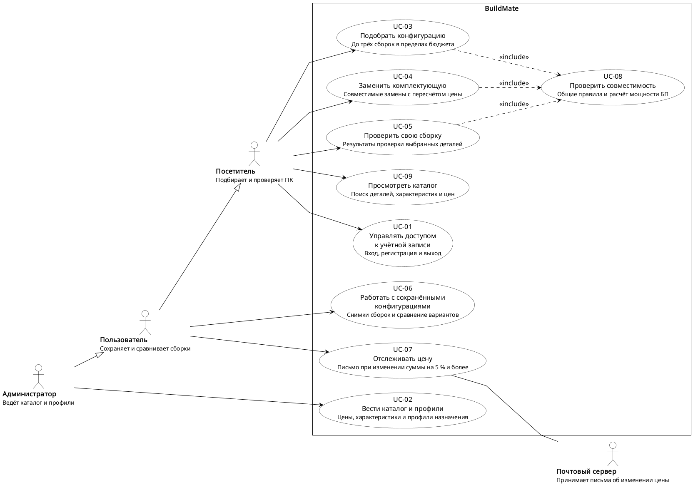

# Актёры и варианты использования BuildMate

Диаграмма вариантов использования показывает общедоступные операции и операции учётных записей. Номера UC-01…07 сохраняют привязку из раздела 4 SRS. UC-08 выделяет общее поведение трёх прецедентов, UC-09 — просмотр каталога.

## Актёры

| Актёр | Роль |
|---|---|
| Посетитель | Выбирает комплектующие в каталоге, запрашивает подбор или проверяет свою сборку. Гостю для этих действий достаточно открыть приложение. |
| Пользователь | Вошедший в систему посетитель. Управляет своими сохранёнными конфигурациями и включает уведомления. |
| Администратор | Пользователь с дополнительными правами на ведение каталога, импорт прайс-листов и изменение профилей назначения. |
| Почтовый сервер | Внешний SMTP-сервер. Принимает письмо от BuildMate и возвращает результат приёма. |

## UC-01. Управлять доступом к учётной записи

**Краткое описание.** Посетитель получает доступ к личному кабинету.  
**Предусловия.** Доступна форма входа. Для входа уже создана учётная запись.  
**Основной поток.**

1. Посетитель вводит e-mail и пароль.
2. BuildMate проверяет данные и состояние блокировки.
3. Открывает сеанс с ролью учётной записи.

**Альтернативные потоки.** Новый посетитель регистрирует уникальный e-mail и пароль от восьми символов. Повторный e-mail отклоняется. При неверном пароле система учитывает попытку. В активном сеансе пользователь может сменить пароль или выйти.  
**Постусловия.** После входа доступны действия роли. После отказа форма остаётся доступной с сообщением об ошибке, после выхода сеанс завершён.

## UC-02. Вести каталог и профили

**Краткое описание.** Администратор поддерживает актуальные характеристики, цены и профили подбора.  
**Предусловия.** Открыт сеанс администратора.  
**Основной поток.**

1. Администратор выбирает создание или изменение позиции.
2. Вводит артикул, данные категории, цену и наличие.
3. Система проверяет обязательные поля и уникальность артикула, сохраняет позицию и фиксирует начальную или изменившуюся цену.

**Альтернативные потоки.** Прайс-лист обновляет цены и наличие по артикулу. Ошибочные строки пропускаются с указанием номеров. Администратор может архивировать позицию, изменить курс валюты или профиль назначения. Профиль с суммой долей бюджета, отличной от 100 %, или суммой весов, отличной от 1, отклоняется.  
**Постусловия.** Принятые изменения доступны последующим подборам. Архивная позиция исключена из подбора, ранее сохранённые снимки сохранены.

## UC-03. Подобрать конфигурацию

**Краткое описание.** Посетитель получает до трёх вариантов ПК для своего бюджета и назначения.  
**Предусловия.** Доступны каталог и профиль выбранного назначения.  
**Основной поток.**

1. Посетитель задаёт бюджет, назначение и ограничения.
2. Система проверяет поля, выбирает доступные позиции и распределяет бюджет по профилю.
3. Для кандидатов выполняет UC-08.
4. Из допустимых сборок формирует «Оптимальную», «Экономную» и «С запасом» по критериям REQ-FUNC-007.
5. Показывает состав, сумму покупки, мощность, индекс, оценку и актуальность цен.

**Альтернативные потоки.** Имеющиеся детали включаются во все варианты без затрат на их покупку. При ошибке поля посетитель исправляет запрос. Если бюджета недостаточно, выводится минимальная необходимая сумма. При иных несовместимых ограничениях указывается причина отсутствия варианта. При просмотре результата можно выбрать валюту, получить предупреждение о дисбалансе игрового ПК или экспортировать конфигурацию в PDF.  
**Постусловия.** На экране доступны подходящие варианты и причины отсутствия остальных либо пояснение, почему подбор невозможен.

## UC-04. Заменить комплектующую

**Краткое описание.** Посетитель меняет деталь в подобранной конфигурации.  
**Предусловия.** Открыт вариант подбора, известны исходный бюджет и профиль.  
**Основной поток.**

1. Посетитель выбирает категорию для замены.
2. Система выполняет UC-08 для кандидатов с остальными деталями.
3. Посетитель выбирает совместимую позицию.
4. Система пересчитывает цену, мощность, индекс и оценку.

**Альтернативные потоки.** Пустой список замен поясняется. Если новая цена превышает бюджет, пересчитанный вариант показывается с предупреждением.  
**Постусловия.** При замене показан обновлённый состав. При отсутствии кандидата сохраняется исходный состав.

## UC-05. Проверить свою сборку

**Краткое описание.** Посетитель узнаёт, какие условия совместимости выполняются для выбранных деталей и какой БП потребуется.  
**Предусловия.** Открыта форма проверки, доступен выбор позиций каталога.  
**Основной поток.**

1. Посетитель выбирает детали и запускает проверку.
2. Сервис проверки запрашивает в каталоге характеристики выбранных артикулов.
3. Для найденных позиций сервис выполняет UC-08 и получает результаты всех применимых правил.
4. Форма показывает условия, их результаты и расчёт мощности, если известны исходные данные.

**Альтернативные потоки.** На шаге 2 позиция могла стать недоступной. Форма указывает её артикул и возвращает посетителя к выбору. На шаге 3 допускается неполная сборка. Если данных недостаточно ни для одного правила, форма предлагает дополнить состав. Нарушения показываются вместе, чтобы посетитель мог исправить несколько позиций за один раз.  
**Постусловия.** Результат относится к проверенному составу. При изменении состава форма сбрасывает прежний результат, после чего проверку можно запустить повторно.

## UC-06. Работать с сохранёнными конфигурациями

**Краткое описание.** Пользователь возвращается к выбранной сборке или сравнивает её с другими.  
**Предусловия.** Пользователь вошёл в систему. Для сохранения открыт вариант, для сравнения доступны собственные сохранённые записи.  
**Основной поток.**

1. Пользователь вводит имя и запрашивает сохранение.
2. Система проверяет длину имени и лимит записей.
3. Записывает снимок и показывает его в личном списке.

**Альтернативные потоки.** Пользователь открывает, переименовывает или удаляет свою запись. Для двух или трёх выбранных записей система выводит таблицу и выделяет отличия. При попытке сохранить 51-ю сборку, ввести имя длиннее 100 символов или сравнить четыре записи система поясняет ограничение.  
**Постусловия.** При сохранении создан полный снимок. При сравнении пользователь видит значения из снимков. Ошибка записи откатывает операцию целиком.

## UC-07. Отслеживать цену

**Краткое описание.** Пользователь узнаёт по почте о существенном изменении стоимости своей конфигурации.  
**Предусловия.** Пользователь вошёл в систему, имеет сохранённую конфигурацию с исходной стоимостью и e-mail.  
**Основной поток.**

1. Пользователь включает отслеживание для своей сборки.
2. При плановой проверке BuildMate пересчитывает её текущую стоимость.
3. При изменении не менее чем на 5 % и свободном суточном лимите система передаёт письмо с исходной и текущей суммами почтовому серверу.
4. После подтверждения приёма фиксирует отправку.

**Альтернативные потоки.** Ниже порога или при исчерпанном лимите система пропускает отправку. При отказе SMTP регистрирует сбой.  
**Постусловия.** Для успешной отправки учтён суточный лимит данной конфигурации. Снимок сохраняет исходную цену.

## UC-08. Проверить совместимость

**Краткое описание.** Получить одинаковую оценку одного состава в подборе, замене и ручной проверке.  
**Предусловия.** UC-03, UC-04 или UC-05 передал выбранные компоненты с характеристиками из каталога.  
**Основной поток.**

1. Модуль определяет применимые правила REQ-FUNC-006.
2. Проверяет каждое условие и фиксирует сравниваемые значения.
3. Вычисляет требуемую мощность, когда известны CPU и используемая графика.
4. Возвращает результаты вызвавшему сценарию.

**Альтернативные потоки.** При нарушении правила обработка остальных продолжается. Если CPU требует дискретную видеокарту и она отсутствует, модуль указывает это нарушение. До выбора карты расчёт мощности недоступен. Для пустого набора сравнивать нечего.  
**Постусловия.** Вызывающий сценарий получает список выполненных и нарушенных условий и доступный расчёт мощности. При подборе и замене несовместимые кандидаты исключаются.

## UC-09. Просмотреть каталог

**Краткое описание.** Посетитель находит модель комплектующей и оценивает её текущую цену и историю.  
**Предусловия.** Открыта страница каталога.  
**Основной поток.**

1. Посетитель вводит название или артикул и выбирает фильтры.
2. Система применяет фильтры совместно и выводит найденные позиции.
3. В выбранной карточке показывает характеристики и точки изменения цены за последние 30 дней.

**Альтернативные потоки.** При отсутствии совпадений система предлагает изменить запрос. При отсутствии точек истории показывает пояснение вместо графика.  
**Постусловия.** Посетитель видит подходящие позиции или причину пустого результата.
