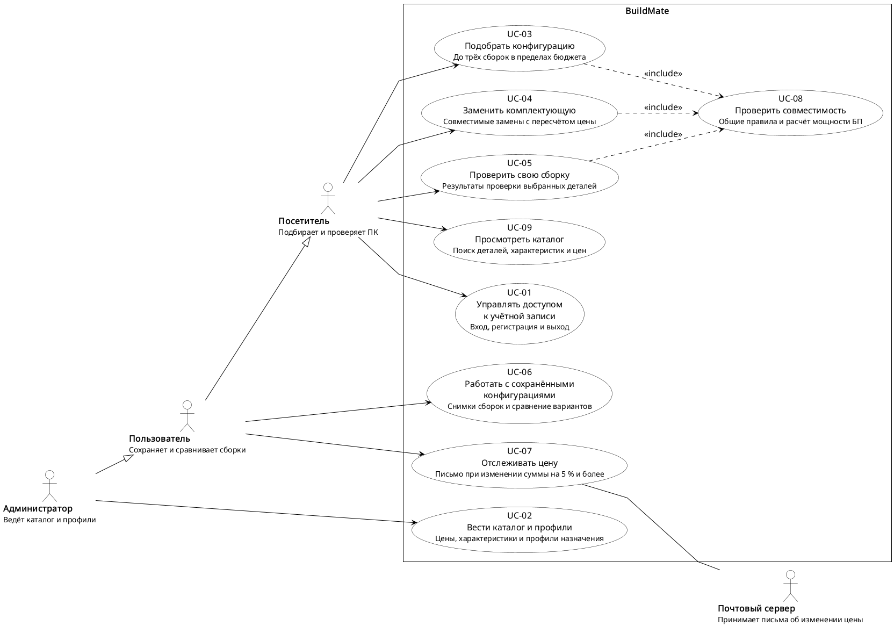
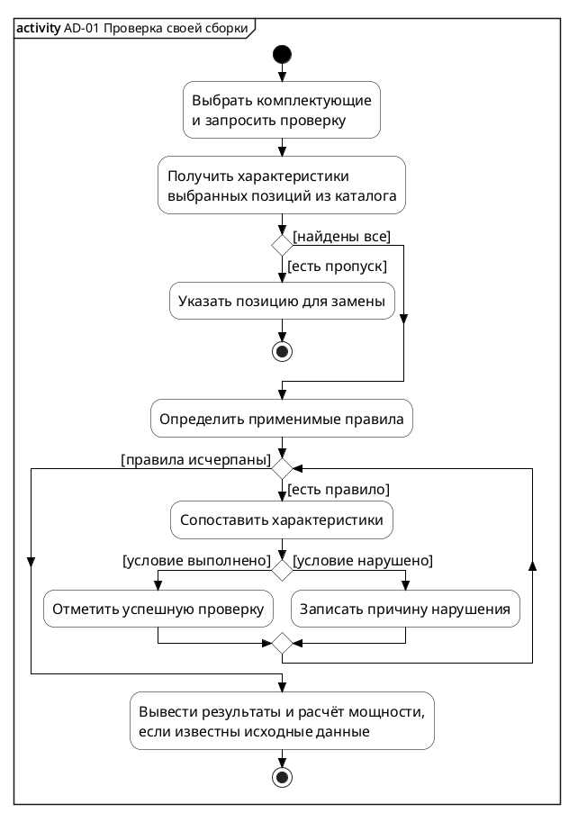
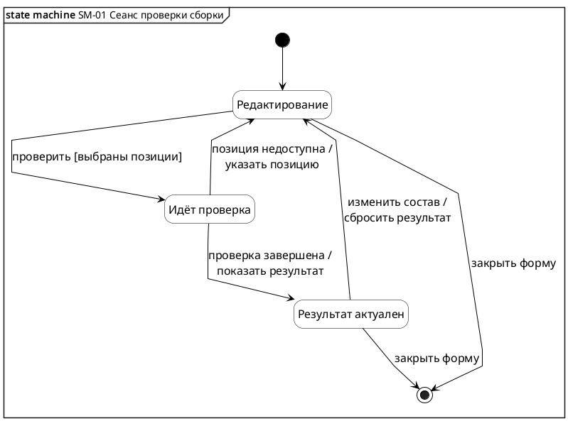
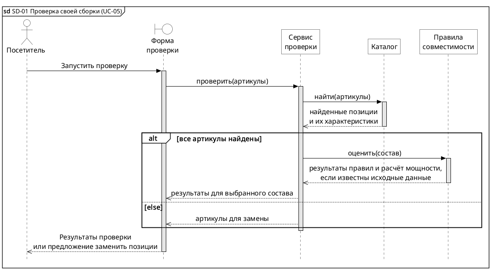

# Описание дизайна программного обеспечения

Для **BuildMate** — системы подбора конфигурации ПК по бюджету и требованиям пользователя

Версия 0.4

Подготовил: Сас Р.Д., гр. 450503

Белорусский государственный университет информатики и радиоэлектроники, кафедра ЭВМ

Дата: 26.11.2026

> В редакции 0.4 добавлена UML-модель поведения BuildMate. План v2 согласован 15.11.2026.

## История изменений

| Автор | Дата | Изменение | Версия |
|---|---|---|---|
| Сас Р.Д. | 12.11.2026 | Начальный вариант SDD по SRS BuildMate v0.2 | 0.1 |
| Сас Р.Д. | 13.11.2026 | Уточнены приоритеты и план итераций по итогам первого раунда обсуждения | 0.2 |
| Сас Р.Д. | 15.11.2026 | Добавлен запрос CR-001, принято решение ADR-0007, обновлены распределение работ и стоимость с junior | 0.3 |
| Сас Р.Д. | 26.11.2026 | Добавлены динамическое представление UML и ADR-0008 | 0.4 |

---

## 1. Введение

### 1.1 Назначение документа

Документ описывает устройство BuildMate и связывает проектные элементы с требованиями из [SRS](../srs/srs.md) и согласованным запросом на изменение CR-001. Он предназначен для заказчика, разработчика и преподавателя: по нему проверяются границы системы, распределение ответственности, архитектурные решения и реалистичность плана. План v2 отражает договорённости двух раундов обсуждения.

### 1.2 Область применения

BuildMate — веб-приложение для подбора совместимых конфигураций ПК, проверки собственной сборки и ведения каталога комплектующих. В согласованный план версии 1.0 входят функции SRS 0.2 и CR-001: просмотр графика цены комплектующей за последние 30 дней. Источником истории являются только ручные изменения каталога и импорт CSV; автоматическое получение цен с сайтов, оформление заказов и платёжные интеграции остаются вне границ релиза. Архитектура рассчитана на один экземпляр приложения и PostgreSQL.

### 1.3 Термины и сокращения

| Термин | Значение |
|---|---|
| ADR | Architectural Decision Record — запись об архитектурном решении и его обосновании |
| BuildMate | Проектируемая система |
| CR | Запрос на изменение согласованного объёма работ (Change Request) |
| Модульный монолит | Одно развёртываемое приложение, разделённое внутри на модули с заданными ответственностями |
| SDD | Software Design Description — описание того, как устроена система |
| SRS | Software Requirements Specification — спецификация того, что должна делать система |
| SMTP | Протокол отправки электронной почты |

### 1.4 Ссылки

| Источник | Тип | Применение |
|---|---|---|
| [SRS BuildMate, версия 0.2](../srs/srs.md) | Нормативный для данного проекта | Источник требований, ограничений и границ релиза |
| `sdd/sdd-template.md` | Справочный | Структура описания дизайна |
| `adr/adr-template.md` | Справочный | Формат отдельных записей архитектурных решений |
| Лабораторная работа №4 | Нормативный | Требует SDD, ADR, оценок, приоритетов, планов и двух раундов обсуждения |
| CR-001 | Согласованный запрос на изменение в плане реализации | Дополняет базовый объём SRS графиком истории цены; оценка и срок приведены в `plan/release-plan.md` |

### 1.5 Обзор документа

Раздел 2 задаёт архитектурный подход и выбранные проектные представления. Раздел 3 содержит представления контекста, модулей, данных, интерфейсов, взаимодействий и развёртывания. Динамическое представление в разделе 3.6 раскрывает сценарий ручной проверки сборки. Раздел 4 фиксирует архитектурные решения, включая ADR-0007 и ADR-0008. Раздел 5 содержит приоритеты, оценки и планы v1 и v2.

---

## 2. Обзор дизайна

### 2.1 Задачи стейкхолдеров

| Стейкхолдер | Основная задача | Что в дизайне её поддерживает |
|---|---|---|
| Гость / покупатель | Получить совместимую сборку в рамках бюджета без регистрации | Модули подбора и совместимости; веб-интерфейс |
| Зарегистрированный пользователь | Сохранить и сравнить сборки, видеть историю цены и получать уведомления | Модули учётных записей, конфигураций, каталога и уведомлений |
| Администратор | Поддерживать каталог, прайс-листы и профили | Модуль каталога и административные операции |
| Заказчик Дашкевич Р.Д. | Согласовать приоритеты, сроки и состав релиза | План v2 и итоги двух раундов в `plan/release-plan.md` |
| Исполнитель Сас Р.Д. | Реализовать и проверить систему в согласованном объёме | Архитектурные решения и координация работ по итерациям |
| Junior-разработчик | Реализовать выделенные интерфейсные и регрессионные задачи | Ограниченный набор задач по каталогу и CR-001 под проверкой исполнителя |
| Владелец / оператор | Развернуть приложение, сохранить данные и наблюдать работу | Контейнерное развёртывание, PostgreSQL, журналы и резервное копирование |

### 2.2 Выбранные точки зрения

| Точка зрения | Включена | Причина |
|---|---:|---|
| Контекст | Да | Показывает пользователей и SMTP как внешнюю систему |
| Композиция / структура | Да | Распределяет функции по модулям и слоям |
| Логическая / информационная | Да | Фиксирует главные сущности и связи данных |
| Интерфейс | Да | Определяет границы веб-, БД- и почтового взаимодействия |
| Взаимодействие / алгоритм | Да | Уточняет сценарии подбора, проверки и уведомления о цене |
| Развёртывание | Да | SRS требует контейнерный запуск приложения и PostgreSQL |
| Физическая топология, конкурентность и внутренние состояния | Пока нет | Для учебной версии с одним экземпляром и одним разработчиком отдельные представления пока не нужны; пересмотреть при изменении масштаба или рисков |

---

## 3. Проектные представления

### 3.1 Контекст

BuildMate предоставляет веб-интерфейс гостю, зарегистрированному пользователю и администратору. Приложение использует PostgreSQL для постоянных данных и внешний SMTP-сервер для писем об изменении цены. Каталог и цены вводятся администратором вручную или импортируются из CSV; прямого соединения с магазинами нет.

```text
Гость ───────────────┐
Пользователь ────────┼── HTTPS / веб-браузер ── BuildMate ── PostgreSQL
Администратор ──────┘                              │
                                                  └── SMTP-сервер (почтовые уведомления)
```

Связанные требования и изменение: REQ-FUNC-001…020, REQ-INT-001…004, REQ-INST-001, CR-001.

### 3.2 Композиция и логическая структура

Предлагается один Java-монолит с внутренним разделением на модули. Это соответствует ограничению SRS на один экземпляр приложения и упрощает первоначальное развёртывание. Выбор конкретного веб-фреймворка, ORM и схемы аутентификации пока не сделан: их нужно согласовать и зафиксировать отдельными ADR до реализации.

| Модуль / слой | Ответственность | Основные требования |
|---|---|---|
| Web / UI | Страницы, формы, валидация запросов, отображение результатов и графика цены | REQ-INT-001, REQ-FUNC-005, 010, 018; CR-001 |
| Учётные записи и доступ | Регистрация, вход, роли, владение сохранёнными данными | REQ-FUNC-001, 002; REQ-SEC-001…004 |
| Каталог и настройки | Комплектующие, фильтрация, CSV-импорт, профили назначения, курс валют и история цены | REQ-FUNC-003, 004, 008, 018, 020; CR-001 |
| Подбор | Принятие бюджета, назначения, требований и уже имеющихся компонентов; построение вариантов | REQ-FUNC-005, 007, 009, 019, 020 |
| Совместимость | Независимые правила проверки сокета, памяти, размеров, мощности и других ограничений | REQ-FUNC-006, 012, 013; REQ-POC-001 |
| Сохранённые конфигурации | Сохранение снимка состава и цен, сравнение, PDF | REQ-FUNC-014…016; REQ-REL-002 |
| Уведомления | По расписанию сравнить сохранённую сумму с текущей и отправить письмо через SMTP | REQ-FUNC-017; REQ-INT-002 |
| Инфраструктурный слой | PostgreSQL, миграции, конфигурация окружения, журналирование | REQ-INT-003, REQ-OBS-001, REQ-INST-001, REQ-BUILD-001 |

Зависимости направлены от веб-слоя к прикладным операциям, затем к доменной логике. Модуль совместимости и алгоритм подбора не должны зависеть от веб-интерфейса или конкретной СУБД (REQ-MAINT-001). Доступ к PostgreSQL и SMTP выполняется через отдельные адаптеры.

По итогам первого раунда заказчик согласовал использование встроенных профилей по умолчанию из приложения В в итерации 1; интерфейс их изменения по REQ-FUNC-008 остаётся в итерации 2.

### 3.3 Информационная модель

| Сущность | Основные данные | Связи / проектное замечание |
|---|---|---|
| User | id, email, passwordHash, role | Владеет нулём или несколькими сохранёнными конфигурациями |
| Component | категория, производитель, название, SKU, цена, наличие, дата цены, ссылка, индекс, характеристики | Используется каталогом, подбором и проверкой совместимости |
| ComponentPriceHistory | componentId, price, recordedAt | Запись при создании позиции и при принятом изменении цены вручную или через CSV; график показывает записи за последние 30 дней (CR-001) |
| Profile | назначение, доли бюджета, веса индексов, допустимые отношения | Используется подбором для расчёта вариантов |
| SavedConfiguration | имя, назначение, бюджет, итоговая цена, дата создания | Принадлежит пользователю; содержит один или более элементов |
| ConfigurationItem | категория, цена, название и характеристики на момент сохранения | Сохраняет снимок данных позиции, чтобы изменение каталога не меняло прошлую конфигурацию (REQ-REL-002) |

Точная схема таблиц, типы полей, индексы, ограничения и миграции будут определены в информационном представлении реализации. Основа — модель данных в приложении Г SRS, требования REQ-INT-003, REQ-REL-002, REQ-COMP-001 и изменение CR-001. В приложении Г SRS сейчас показаны снимки названия, категории и цены, но REQ-REL-002 требует также сохранить характеристики. Перед фиксацией схемы данных нужно расширить модель SRS или согласовать точный состав снимка с заказчиком.

### 3.4 Интерфейсы и взаимодействия

| Граница | Направление и данные | Обработка ошибок |
|---|---|---|
| Браузер ↔ веб-приложение | Формы требований, каталог, график истории цены, результаты подбора и проверки; сессия пользователя | Валидация полей; при отсутствии истории показывается понятное пустое состояние |
| Приложение ↔ PostgreSQL | Учётные записи, каталог, история цен, профили, сохранённые конфигурации | Транзакции для связанных изменений; ошибка БД не должна показывать частично сохранённую конфигурацию |
| Приложение → SMTP | Письмо о достижении порога изменения цены | Ошибка отправки журналируется и повторяется по согласованной политике; SMTP недоступность не останавливает подбор и каталог |
| Администратор → импорт CSV | Строки прайс-листа и наличие комплектующих | Некорректные строки отклоняются с отчётом; окончательный формат CSV задаёт REQ-INT-004 |

#### Сценарий истории цены CR-001

При создании комплектующей и при каждом успешном изменении цены администратором или импортом CSV приложение записывает цену и время изменения в `ComponentPriceHistory` в одной транзакции с обновлением каталога. Страница каталога запрашивает записи выбранной комплектующей за последние 30 дней и отображает график. История не вызывает обращения к сайтам магазинов и не заменяет отметку актуальности цены по REQ-FUNC-010.

#### Сценарий подбора

1. Пользователь указывает бюджет, назначение и ограничения; при необходимости — уже имеющиеся компоненты.
2. Веб-слой проверяет ввод и передаёт запрос модулю подбора.
3. Модуль загружает подходящие позиции каталога и профиль назначения.
4. Правила совместимости отбрасывают непригодные наборы; алгоритм формирует «Оптимальную» конфигурацию с наибольшим индексом в пределах бюджета, «Экономную» — не дороже 85 % бюджета и не ниже 90 % индекса оптимальной, а для «С запасом» проверяет блок питания не менее 1,6 × (P_CPU + P_GPU + 100) и свободные слоты памяти и M.2 (REQ-FUNC-007).
5. Приложение возвращает до трёх вариантов, их состав, цену, актуальность цен (устаревшие старше 7 суток отмечаются) и пояснение к оценке.

Подбор должен уложиться в 5 секунд для 95 % запросов (REQ-PERF-002). Конкретный алгоритм оптимизации и поведение при отсутствии допустимого решения уточнить и подтвердить прототипом REQ-POC-001 до реализации полного сценария.

#### Сценарий отслеживания цены

Плановая задача периодически выбирает конфигурации с включённым отслеживанием, сравнивает сохранённую сумму с суммой по актуальному каталогу, проверяет порог 5 % и ограничение на одно письмо в сутки, затем отправляет письмо через SMTP. Расписание и политика повторных отправок пока являются проектными предположениями и подлежат согласованию.

### 3.5 Развёртывание и эксплуатация

Предварительная целевая схема — Docker Compose с одним контейнером приложения и одним PostgreSQL, запускаемая командой `docker compose up` (REQ-INST-001). Параметры подключения к БД, SMTP и секреты передаются через переменные окружения. База данных сохраняет состояние в постоянном томе; резервные копии выполняются по REQ-REL-001. Для проверки работоспособности нужны структурированные журналы и мониторинг по REQ-OBS-001.

Не определены: место размещения, частота резервного копирования, целевые RPO/RTO, способ хранения секретов в production. Эти детали нельзя считать согласованными только на основании данного SDD.

### 3.6 Динамическое представление UML

Модель охватывает цели актёров в пределах BuildMate. Подробные предусловия, потоки и постусловия каждого прецедента приведены в [описании сценариев](../docs/lab5/use-cases.md). Термины и проверяемые ограничения вынесены в [глоссарий](../docs/lab5/glossary.md) и [дополнительные спецификации](../docs/lab5/additional-specifications.md).

#### Варианты использования

Посетитель просматривает каталог, подбирает конфигурацию, заменяет деталь или проверяет свою сборку. Три операции над составом включают UC-08. Это позволяет применять одни и те же правила совместимости при разных целях покупателя.

Вошедший пользователь управляет своими конфигурациями и отслеживает цену. Администратор также ведёт каталог и профили. Внешний почтовый сервер участвует в отправке уведомления.



#### Активность проверки собственной сборки

Если выбранная позиция стала недоступной, UC-05 возвращает посетителю её артикул. Иначе UC-08 оценивает все применимые правила. Даже при первом нарушении обработка продолжается, чтобы пользователь увидел все причины за один запуск.



#### Состояния сеанса проверки

Объект модели — сеанс работы с формой проверки. Он начинается в состоянии редактирования. По завершении вычислений результат относится к текущему составу, даже если выявлены нарушения. Изменение состава сбрасывает результат, закрытие формы завершает сеанс.



#### Последовательность взаимодействий

Форма передаёт сервису артикулы, а сервис загружает из каталога характеристики. Когда найдены все позиции, сервис вызывает модуль совместимости и возвращает форме расчёт и пояснения. В ветви [else] сервис возвращает форме артикулы для замены. Форма показывает ответ посетителю. Сплошные стрелки обозначают синхронные вызовы, пунктирные — ответы, узкие прямоугольники на линиях жизни — периоды выполнения.



Исходники диаграмм и описания прецедентов приведены в [материалах ЛР5](../docs/lab5/README.md).

---

## 4. Архитектурные решения

ADR-001…006 содержат проектные предложения и остаются в статусе `proposed`. По итогам второго раунда принято решение ADR-0007 о хранении истории цен.

| ID | Предварительное решение | Основание | Что записать в ADR |
|---|---|---|---|
| ADR-001 | Модульный монолит вместо набора микросервисов | Один экземпляр приложения по SRS; учебный масштаб; ниже сложность сборки и эксплуатации | Сравнить монолит и микросервисы, отметить последствия для масштабирования |
| ADR-002 | PostgreSQL как основная СУБД | Прямое ограничение REQ-INT-003 | Схема данных, миграции, резервное копирование; тестовая СУБД H2 разрешена SRS |
| ADR-003 | Детерминированный подбор и явные правила совместимости | Профили и контрольные примеры заданы SRS; ML не применяется | Сравнить перебор/эвристический поиск, критерии остановки и обработку отсутствия решения |
| ADR-004 | Выбор Java-веб-фреймворка и ORM | SRS задаёт Java 21, но не конкретные библиотеки | Сравнить варианты по навыкам, времени разработки, сопровождению и открытой лицензии |
| ADR-0007 | Хранить историю цен комплектующих в PostgreSQL | CR-001; цены поступают из ручного ввода и CSV, отдельная инфраструктура не требуется | Принято; детали и последствия приведены в [ADR-0007](../adr/0007-component-price-history.md) |
| ADR-0008 | Моделировать цели актёров и детализировать UC-05 диаграммами активности, состояний и последовательности | REQ-FUNC-006, 012 | Принято для модели ЛР5. Механизмы построения и смысл связей описаны в [ADR-0008](../adr/0008-uml-dynamic-behavior.md) |

Для новых ADR использовать шаблон `../adr/adr-template.md`; статус и последствия фиксировать в соответствующей записи.

---

## 5. Приоритеты, оценки и планы после обсуждений

Оценки функций подтверждены для планирования после разбора крупных задач с заказчиком; погрешность остаётся ориентировочно ±30 %. Приоритеты ранжированы по шкале из задания: 10 — наивысший, 50 — минимальный; эти значения дополняют, но не заменяют MoSCoW в SRS. По итогам обсуждения повышены REQ-FUNC-004 и REQ-FUNC-019. Функциональные оценки включают анализ задачи, реализацию и первичную проверку.

| Требование | Функция | Приоритет | Оценка, ч | Итерация из SRS |
|---|---|---:|---:|---:|
| REQ-FUNC-001 | Регистрация и вход | 10 | 24 | 1 |
| REQ-FUNC-002 | Роли и права | 10 | 12 | 1 |
| REQ-FUNC-003 | Каталог комплектующих | 10 | 20 | 1 |
| REQ-FUNC-004 | Импорт прайс-листа CSV | 20 | 12 | 2 |
| REQ-FUNC-005 | Ввод требований | 10 | 12 | 1 |
| REQ-FUNC-006 | Правила совместимости | 10 | 32 | 1 |
| REQ-FUNC-007 | Подбор конфигураций | 10 | 40 | 1 |
| REQ-FUNC-008 | Профили назначения | 30 | 12 | 2 |
| REQ-FUNC-009 | Индекс производительности и оценка соответствия | 10 | 20 | 1 |
| REQ-FUNC-010 | Просмотр конфигурации, цены и ссылок | 10 | 14 | 1 |
| REQ-FUNC-011 | Замена комплектующей | 20 | 16 | 2 |
| REQ-FUNC-012 | Проверка собственной сборки | 20 | 14 | 2 |
| REQ-FUNC-013 | Предупреждение о дисбалансе | 40 | 8 | 3 |
| REQ-FUNC-014 | Сохранение конфигураций | 20 | 16 | 2 |
| REQ-FUNC-015 | Сравнение конфигураций | 30 | 12 | 2 |
| REQ-FUNC-016 | Экспорт в PDF | 40 | 12 | 3 |
| REQ-FUNC-017 | Отслеживание цены | 40 | 20 | 3 |
| REQ-FUNC-018 | Просмотр каталога | 20 | 8 | 2 |
| REQ-FUNC-019 | Имеющиеся комплектующие | 20 | 12 | 2 |
| REQ-FUNC-020 | Переключение валюты | 50 | 8 | 3 |
| **Итого по функциональным требованиям** |  |  | **324** |  |

До итерации 1 выполняется POC совместимости REQ-POC-001 (16 ч). План v1 дополнительно включает 12 ч на инфраструктуру, 60 ч на нефункциональные требования и 32 ч на интеграционную и приёмочную проверку. Его оценка — 444 ч.

### 5.1 План v1 по итогам первого раунда

План сохраняет три итерации, предусмотренные REQ-DEAD-001, и весь функциональный объём SRS. Первая итерация длится 6 недель, вторая и третья — по 3 недели; расчётная доступность исполнителя — 40 ч/неделю.

| Итерация | Состав | Ёмкость | Плановая оценка |
|---|---|---:|---:|
| 1 — базовый каталог и подбор | POC-001; REQ-FUNC-001, 002, 003, 005, 006, 007, 009, 010; инфраструктура 12 ч; часть NFR 20 ч | 240 ч | 222 ч |
| 2 — расширение сценариев | REQ-FUNC-004, 008, 011, 012, 014, 015, 018, 019; часть NFR 18 ч | 120 ч | 120 ч |
| 3 — дополнительные функции и выпуск | REQ-FUNC-013, 016, 017, 020; часть NFR 22 ч; интеграционная и приёмочная проверка 32 ч | 120 ч | 102 ч |
| **Итого** | **3 итерации / 12 недель** | **480 ч** | **444 ч; резерв 36 ч** |

В оценку входят 324 ч по функциональным требованиям, 16 ч по POC, 12 ч инфраструктурной основы, 60 ч работ по нефункциональным требованиям и 32 ч интеграционной/приёмочной проверки. NFR-работы включают безопасность и доступ, производительность, резервное копирование и неизменность сохранённых данных, журналы и мониторинг, доступность и браузерную проверку. Календарные даты будут добавлены после сверки с графиком курса.

### 5.2 План v2 по итогам второго раунда

CR-001 — история цены комплектующей за последние 30 дней с графиком в каталоге. Приоритет — 20, оценка — 56 ч. История формируется только из ручных изменений каталога и импорта CSV; автоматический сбор с сайтов не входит в объём.

| Итерация | Срок | Работа исполнителя | Работа junior | Ёмкость | Оценка / резерв |
|---|---:|---|---|---:|---:|
| 1 — каталог и совместимость | 6 недель | 240 ч, включая 18 ч интеграционной проверки, перенесённой из итерации 3 | — | 240 ч | 240 ч / 0 ч |
| 2 — расширение сценариев и подготовка CR-001 | 3 недели | 104 ч базовых задач + 16 ч проектирования CR-001 | 16 ч: REQ-FUNC-018 (8 ч) и регрессионные проверки REQ-FUNC-004 (8 ч) | 136 ч | 136 ч / 0 ч |
| 3 — выпуск и история цены | 3 недели | 84 ч базовых задач + 16 ч интеграции CR-001 | 24 ч интерфейса графика и проверок CR-001 | 144 ч | 124 ч / 20 ч |
| **Итого** | **12 недель** | **460 ч** | **40 ч** | **520 ч** | **500 ч / 20 ч** |

При ставке исполнителя 15 BYN/ч и junior 7,50 BYN/ч стоимость плана v2 составляет 7 200 BYN: 460 × 15 + 40 × 7,50. План v1 оценён в 6 660 BYN; увеличение — 540 BYN (8,1 %). Это стоимость трудозатрат, не хостинга. Детали второго раунда приведены в [переписке](../plan/customer-round-2.md) и [плане релиза](../plan/release-plan.md).

---

## Открытые вопросы к заказчику

1. Каковы календарные даты начала и завершения итераций по графику курса?
2. Каковы периодичность фоновой проверки цены и политика повторной отправки при сбое SMTP?
3. Согласовать модель данных: REQ-REL-002 требует сохранять характеристики на момент сохранения, но приложение Г SRS пока не показывает характеристики в ConfigurationItem.
