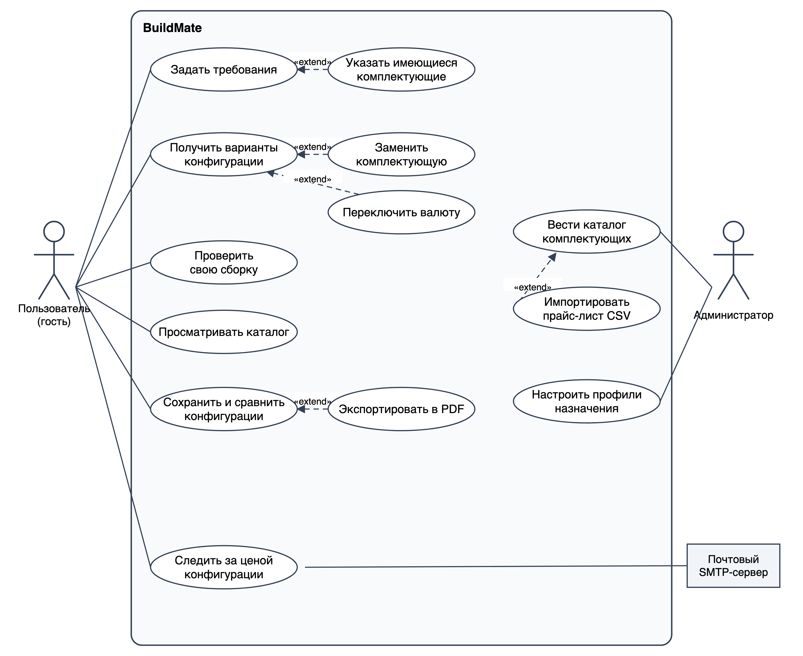
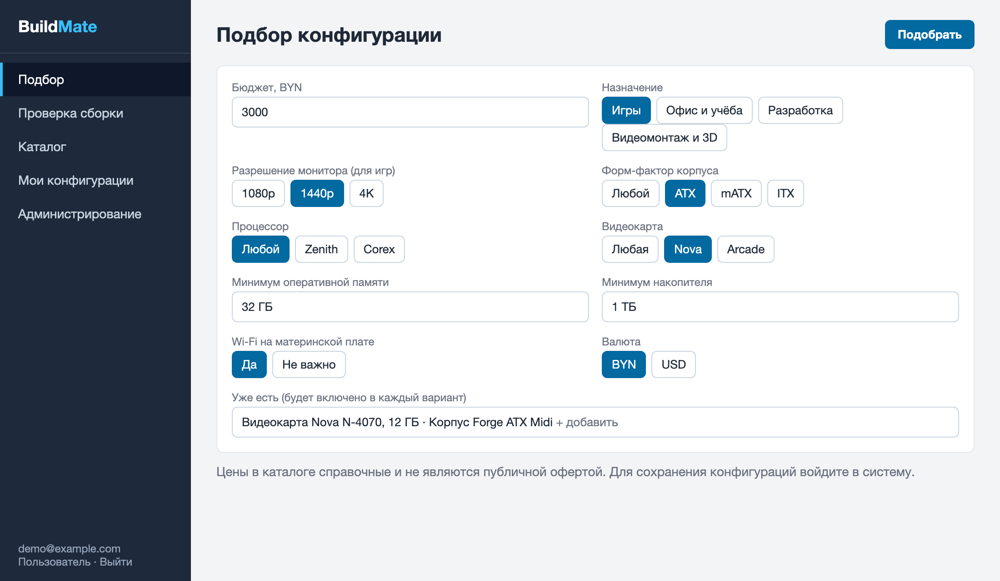
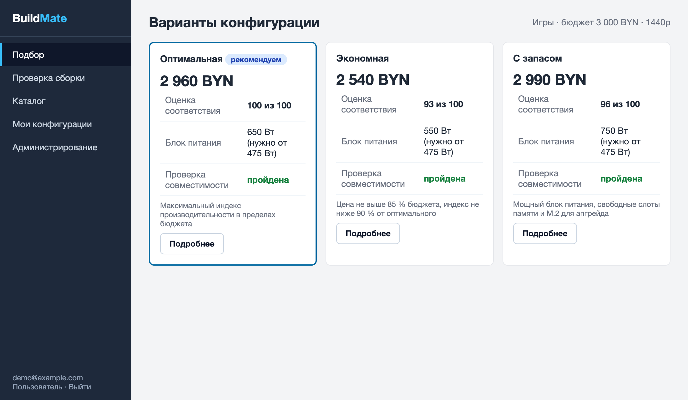
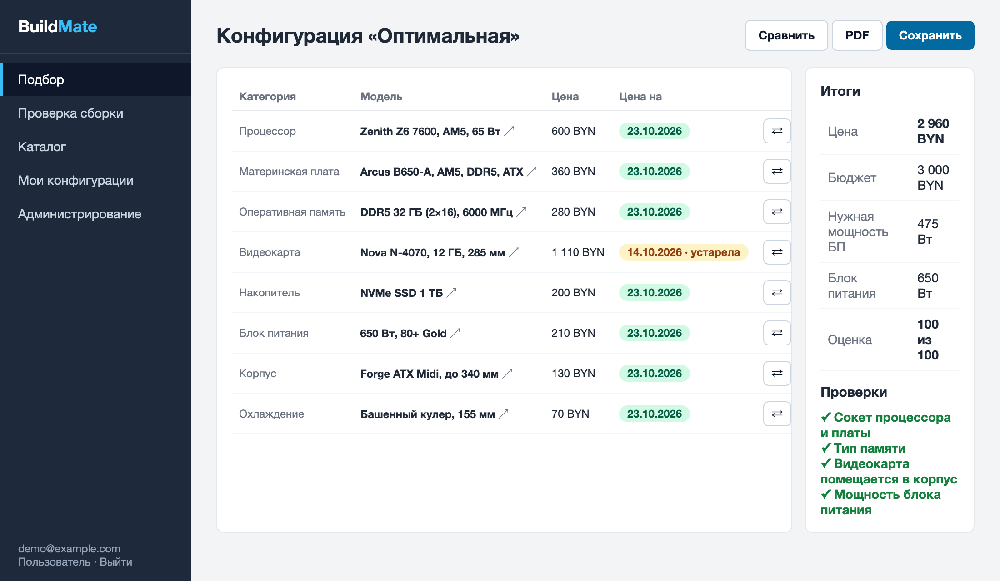
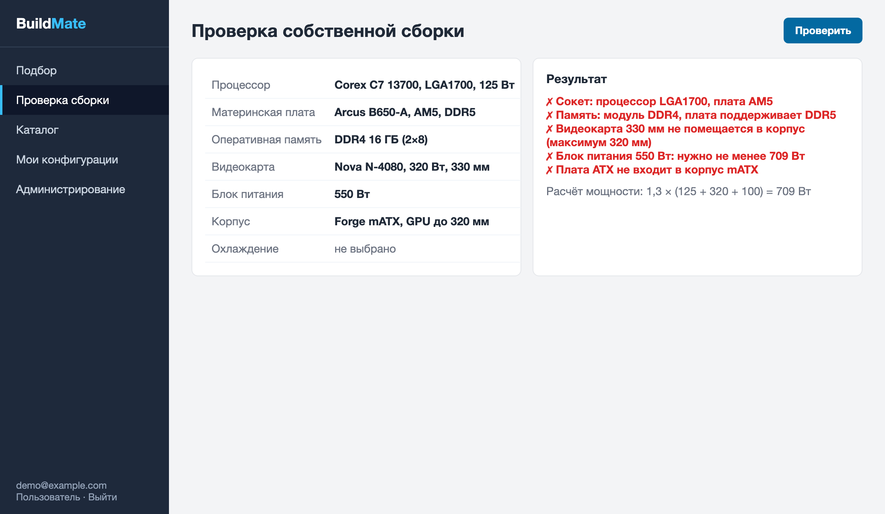
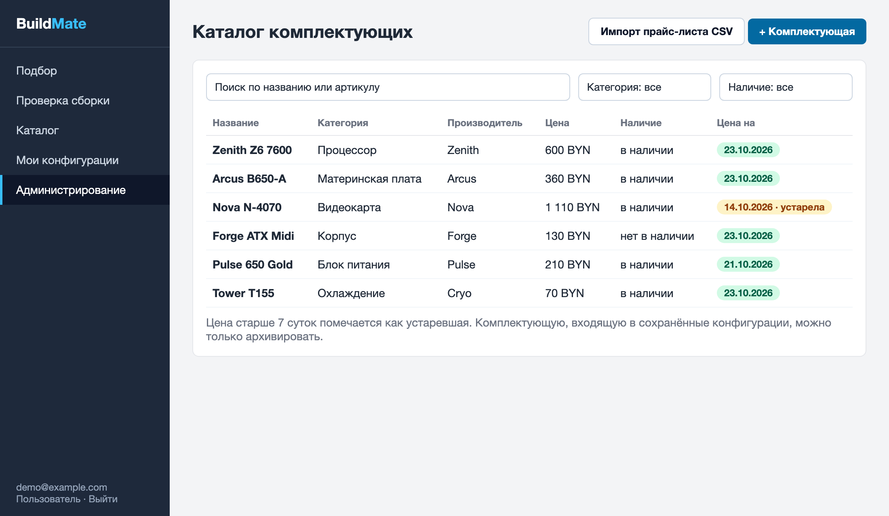

# Спецификация требований к ПО

Для **BuildMate** – системы подбора конфигурации ПК по бюджету и требованиям пользователя

Версия 0.2

Подготовил Сас <<И. О.>>, группа 450503

Белорусский государственный университет информатики и радиоэлектроники, кафедра электронных вычислительных машин

26.10.2026

## Оглавление

* [1. Введение](#1-введение)
* [2. Обзор продукта](#2-обзор-продукта)
* [3. Требования](#3-требования)
  * [3.1 Внешние интерфейсы](#31-внешние-интерфейсы)
  * [3.2 Функциональные требования](#32-функциональные-требования)
  * [3.3 Качество обслуживания](#33-качество-обслуживания)
  * [3.4 Соответствие стандартам](#34-соответствие-стандартам)
  * [3.5 Проектирование и реализация](#35-проектирование-и-реализация)
  * [3.6 ИИ/МО](#36-иимо)
* [4. Верификация](#4-верификация)
* [5. Приложения](#5-приложения)

## История изменений

| Name | Date | Reason For Changes | Version |
|------|------|--------------------|---------|
| Сас <<И. О.>> | 26.10.2026 | Первая версия: интервью с заказчиком, функциональные (REQ-FUNC-001…018) и нефункциональные требования, мокапы, диаграммы SysML v2 | 0.1 |
| Сас <<И. О.>> | <<дата>> | По итогам рецензии (pull request <<№>>): добавлены REQ-FUNC-019 и REQ-FUNC-020, дополнено REQ-FUNC-010; два замечания отклонены (см. 2.6 и приложение А) | 0.2 |

---

## 1. Введение

Документ описывает требования к веб-приложению **BuildMate** – системе подбора оптимальной конфигурации персонального компьютера по бюджету и требованиям пользователя. Раздел 2 даёт общий контекст, раздел 3 содержит проверяемые требования, раздел 4 – матрицу верификации, раздел 5 – приложения.

### 1.1 Назначение документа

SRS определяет, **что** система должна делать, но не **как** она будет построена. Документ предназначен для разработчика (студент, он же менеджер проекта), заказчика (напарник по ролевой игре, затем преподаватель), будущих тестировщиков и рецензентов. Проектные решения вынесены в документ проектирования (SDD) и записи архитектурных решений (ADR) следующих лабораторных работ.

### 1.2 Область применения продукта

Продукт – BuildMate, версия 1.0 (учебный проект по дисциплине «Жизненный цикл разработки программного обеспечения»).

Покупателю компьютера трудно выбрать из сотен комплектующих набор, который помещается в бюджет, подходит под задачи и при этом совместим: процессор должен подходить к сокету платы, память – к её типу, видеокарта – помещаться в корпус, а блок питания – тянуть всю систему. Ошибка обнаруживается уже после покупки. BuildMate решает эту задачу:

- по бюджету и требованиям подбирает до трёх вариантов конфигурации, которые заведомо совместимы между собой;
- показывает цену, расчётную мощность, индекс производительности и оценку соответствия каждого варианта;
- позволяет заменить комплектующую, проверить собственную сборку, сохранить и сравнить конфигурации;
- даёт администратору инструменты ведения каталога, прайс-листов и профилей назначения.

**Бизнес-цели:**

- БЦ-1 – исключить несовместимые сборки: ноль нарушений правил совместимости в вариантах, предложенных на контрольном наборе из 100 запросов;
- БЦ-2 – скорость подбора: от ввода требований до получения вариантов не более 1 минуты, из них расчёт не более 5 секунд;
- БЦ-3 – соблюдение бюджета: цена каждого предложенного варианта не превышает бюджет пользователя.

**Входит в версию 1.0:** роли гость, пользователь и администратор; каталог комплектующих и импорт прайс-листов из CSV; подбор до трёх вариантов; профили назначения; индекс и оценка соответствия; замена комплектующих; проверка собственной сборки; сохранение и сравнение конфигураций; экспорт в PDF; отслеживание цены по e-mail.

**Не входит в версию 1.0:** автоматическая загрузка цен из магазинов (парсинг сайтов, API), оформление заказа и оплата, подбор ноутбуков и периферии, оценка частоты кадров в конкретных играх, сборка и доставка, мобильное приложение.

### 1.3 Определения, акронимы и сокращения

| Term | Definition |
|------|------------|
| Бюджет | Наибольшая допустимая суммарная цена конфигурации, указанная пользователем |
| Индекс производительности | Число от 1 до 100, характеризующее производительность процессора или видеокарты; задаётся администратором |
| Каталог | Набор комплектующих с характеристиками, ценами и наличием |
| Комплектующая | Компонент компьютера одной из восьми категорий каталога |
| Конфигурация | Набор комплектующих, образующий компьютер |
| Назначение | Основная задача компьютера: игры, офис и учёба, разработка, видеомонтаж и 3D |
| Оценка соответствия | Число от 0 до 100, показывающее долю индекса конфигурации от наибольшего среди найденных вариантов |
| Профиль назначения | Набор долей бюджета по категориям и весов индексов для одного назначения |
| Совместимость | Выполнение всех условий REQ-FUNC-006 для набора комплектующих |
| Прайс-лист | Файл CSV с актуальными ценами и наличием комплектующих |
| Сокет | Тип разъёма процессора на материнской плате (например, AM5, LGA1700) |
| Форм-фактор | Стандартный размер материнской платы или корпуса (ATX, mATX, ITX) |
| TDP | Thermal Design Power – типичное тепловыделение компонента, Вт |
| БП | Блок питания |
| DDR4, DDR5 | Типы оперативной памяти |
| M.2 | Разъём и формат твердотельных накопителей |
| CSV | Comma-Separated Values – текстовый формат табличных данных |
| MoSCoW | Метод приоритизации: Must, Should, Could, Won't |
| SRS | Software Requirements Specification – спецификация требований к ПО |
| SysML v2 | Systems Modeling Language, версия 2 – язык моделирования систем |
| SMTP | Simple Mail Transfer Protocol – протокол отправки почты |

### 1.4 Ссылки

| Источник | Тип | Расположение |
|----------|-----|--------------|
| ISO/IEC/IEEE 29148:2018. Systems and software engineering – Life cycle processes – Requirements engineering | нормативная | – |
| IEEE 830-1998. Recommended Practice for Software Requirements Specifications | справочная | – |
| Шаблон SRS кафедры ЭВМ БГУИР | нормативная | `srs/srs-template.md` |
| Лабораторная работа № 3 «Разработка и документирование бизнес-требований» | нормативная | методические указания кафедры |
| Закон Республики Беларусь от 7 мая 2021 г. № 99-З «О защите персональных данных» | нормативная | pravo.by |
| SysML v2 – файл с моделью требований | справочная | `srs/sysml/buildmate.sysml` |

### 1.5 Обзор документа

Раздел 2 описывает продукт, пользователей, ограничения и допущения. Раздел 3 содержит требования с идентификаторами вида `REQ-[AREA]-[NNN]`, ключевые слова «должен» (обязательное), «следует» (желательное), «может» (допустимое). Приоритет функциональных требований задан по MoSCoW. Раздел 4 связывает требования со способами проверки. Любое изменение требования фиксируется в истории изменений и повышает версию документа.

---

## 2. Обзор продукта

### 2.1 Перспектива продукта

BuildMate – новый самостоятельный продукт. Он заменяет ручной подбор по сайтам магазинов и таблицам совместимости. Система состоит из веб-приложения на Java и реляционной базы данных; из внешних систем использует только почтовый SMTP-сервер (для необязательного отслеживания цены). Данные каталога вводит администратор: вручную или загрузкой прайс-листов. Владельцем и администратором учебной версии является разработчик. На рисунке 1 показаны участники и варианты использования.

### 2.2 Функции продукта

- ведение каталога комплектующих и профилей назначения, импорт прайс-листов;
- ввод требований пользователя и подбор до трёх вариантов конфигурации;
- проверка совместимости, замена комплектующих, проверка собственной сборки;
- расчёт индекса производительности и оценки соответствия;
- сохранение, сравнение конфигураций, экспорт в PDF, отслеживание цены.

Иерархия функциональных требований показана на рисунке 2 (светло-жёлтым выделены требования, добавленные в версии 0.2).

### 2.3 Ограничения продукта

- Продукт должен быть веб-приложением на языке Java (Java Web); версия JDK не ниже 21.
- Продукт должен использовать реляционную СУБД PostgreSQL (для автотестов допускается H2).
- Продукт должен использовать только программное обеспечение с открытой лицензией.
- Интерфейс должен быть на русском языке; цены указываются в белорусских рублях.
- Данные должны храниться на сервере, развёрнутом владельцем системы; передача данных третьим сторонам запрещена, кроме отправки писем на e-mail самого пользователя.

### 2.4 Характеристики пользователей

| Класс пользователей | Описание | Частота работы | Права |
|---------------------|----------|----------------|-------|
| Гость | Покупатель, не прошедший вход; технической подготовки не требуется | Эпизодически, 5–15 минут на подбор | Подбор, проверка сборки, просмотр каталога без сохранения |
| Пользователь | Зарегистрированный покупатель | Несколько раз за период выбора | Дополнительно: сохранение, сравнение, экспорт, отслеживание цены |
| Администратор | Владелец сервиса, знающий комплектующие | Ежедневно или еженедельно | Дополнительно: ведение каталога, прайс-листов и профилей |

Требования доступности: контраст текста не ниже 4,5:1, управление основными действиями с клавиатуры.

### 2.5 Допущения и зависимости

| Допущение / зависимость | Влияние при невыполнении |
|-------------------------|--------------------------|
| Характеристики и индексы производительности вводит администратор по открытым источникам | Ошибка в данных приводит к неверному результату подбора; нужен контроль при вводе |
| Цены актуализируются администратором (вручную или прайс-листом CSV) не реже одного раза в 7 суток | Цены помечаются устаревшими, ценность подбора снижается |
| Индексы процессоров и видеокарт заданы по единой шкале от 1 до 100 | Расчёты по REQ-FUNC-009 и REQ-FUNC-013 теряют смысл |
| Размер каталога не превышает 5000 комплектующих | Потребуется пересмотр REQ-PERF-001 и REQ-PERF-002 |
| Доступен SMTP-сервер (REQ-FUNC-017) | Отслеживание цены недоступно; остальные функции работают без изменений |

### 2.6 Распределение требований

| Итерация | Содержание | Требования |
|----------|------------|------------|
| 1 | Каталог и подбор | REQ-FUNC-001, 002, 003, 005, 006, 007, 009, 010 |
| 2 | Проверка, замена, профили, сохранение | REQ-FUNC-004, 008, 011, 012, 014, 015, 018, 019 |
| 3 | Дополнительные возможности | REQ-FUNC-013, 016, 017, 020 |
| 1–3 | Нефункциональные | REQ-INT, PERF, SEC, REL, AVAIL, OBS, COMP, INST, BUILD, PORT, MAINT, COST, DEAD, POC, CM |

**Результат рецензирования (версия 0.2, pull request <<№>>).** Принято: возможность указать уже имеющиеся комплектующие (REQ-FUNC-019), дата актуальности цены и ссылка на магазин (дополнение REQ-FUNC-010), переключение валюты (REQ-FUNC-020). Отклонено: показ ожидаемой частоты кадров в конкретных играх (требует базы результатов тестирования и прав на её использование, поэтому используется индекс производительности); оформление заказа и оплата через систему (требует интеграции с магазинами и платёжными системами, что выходит за границы версии 1.0). Подробности – в приложении А.

---

## 3. Требования

### 3.1 Внешние интерфейсы

#### 3.1.1 Пользовательские интерфейсы

Интерфейс состоит из боковой навигации (Подбор, Проверка сборки, Каталог, Мои конфигурации, Администрирование) и рабочей области. Цветом выделяются успешные и нарушенные проверки, при этом результат всегда дублируется текстом и значком. Для пустых списков показывается подсказка; ошибки ввода показываются рядом с полем.

Мокапы экранов:

Исходники мокапов (HTML) лежат в `srs/mockups/`.

- **ID:** REQ-INT-001
- **Title:** Русскоязычный адаптивный веб-интерфейс
- **Statement:** Система должна предоставлять интерфейс на русском языке, корректно отображаемый при ширине окна от 360 до 1920 пикселей.
- **Rationale:** Подбирать комплектующие удобно и с телефона, в магазине.
- **Acceptance Criteria:** Все экраны из рисунков 3–7 открываются без горизонтальной прокрутки при ширине 360 пикселей.
- **Verification Method:** Inspection
- **More Information:** Рисунки 3–7.

#### 3.1.2 Аппаратные интерфейсы

Специальные аппаратные интерфейсы не требуются. Система работает на любом сервере или компьютере с поддержкой Java 21 и не менее 2 ГБ оперативной памяти.

#### 3.1.3 Программные интерфейсы

- **ID:** REQ-INT-002
- **Title:** Отправка почты по SMTP
- **Statement:** Система может отправлять письма через SMTP-сервер, параметры которого (адрес, порт, логин, пароль, шифрование) задаются в конфигурации окружения.
- **Rationale:** Нужна для отслеживания цены.
- **Acceptance Criteria:** При недоступном SMTP-сервере отправка отмечается ошибкой в журнале, остальные функции продолжают работать.
- **Verification Method:** Test
- **More Information:** REQ-FUNC-017.

- **ID:** REQ-INT-003
- **Title:** Хранение данных в PostgreSQL
- **Statement:** Система должна хранить данные в реляционной базе PostgreSQL версии не ниже 15, схема создаётся и изменяется скриптами миграций.
- **Rationale:** Нужны транзакции и ограничения целостности.
- **Acceptance Criteria:** На пустой базе приложение самостоятельно создаёт схему при первом запуске.
- **Verification Method:** Test
- **More Information:** Модель данных – рисунок Г.1.

- **ID:** REQ-INT-004
- **Title:** Формат прайс-листа CSV
- **Statement:** Файл прайс-листа должен иметь кодировку UTF-8, разделитель «;» (допускается «,»), первую строку-заголовок и столбцы «артикул», «цена», «наличие»; цена записывается числом с десятичной точкой или запятой, наличие – значениями «да» и «нет».
- **Rationale:** Файл должен готовиться в табличном процессоре.
- **Acceptance Criteria:** Файл, сохранённый из Excel с кодировкой UTF-8, загружается без искажений; значения в других форматах помечаются как ошибочные строки.
- **Verification Method:** Test
- **More Information:** REQ-FUNC-004.

### 3.2 Функциональные требования

Модель данных, на которую опираются требования, приведена в приложении Г, значения профилей назначения – в приложении В.

#### 3.2.1 Доступ и роли

- **ID:** REQ-FUNC-001
- **Title:** Регистрация и вход
- **Statement:** Система должна позволять пользователю зарегистрироваться (e-mail, пароль не короче 8 символов), войти, выйти и сменить пароль. Гость, не прошедший вход, должен иметь возможность подбирать и проверять конфигурации без сохранения.
- **Rationale:** Подбор не должен требовать регистрации, а сохранение и сравнение требуют личного кабинета.
- **Acceptance Criteria:** Повторная регистрация с тем же e-mail отклоняется; страницы сохранённых конфигураций недоступны без входа; страницы подбора доступны гостю.
- **Verification Method:** Test
- **More Information:** Приоритет Must. REQ-SEC-001, REQ-SEC-004.

- **ID:** REQ-FUNC-002
- **Title:** Роли и права доступа
- **Statement:** Система должна различать три роли: гость (подбор и проверка без сохранения), пользователь (дополнительно сохранение и сравнение конфигураций), администратор (дополнительно ведение каталога, прайс-листов и профилей назначения). Страницы администрирования должны быть недоступны другим ролям.
- **Rationale:** Каталог и профили определяют результат подбора и не должны изменяться посторонними.
- **Acceptance Criteria:** Обращение гостя или пользователя к любой странице администрирования возвращает отказ в доступе; администратор получает доступ ко всем страницам.
- **Verification Method:** Test
- **More Information:** Приоритет Must. REQ-SEC-002.

#### 3.2.2 Каталог комплектующих

- **ID:** REQ-FUNC-003
- **Title:** Каталог комплектующих
- **Statement:** Система должна позволять администратору создавать, изменять и архивировать комплектующие восьми категорий: процессор, материнская плата, оперативная память, видеокарта, накопитель, блок питания, корпус, охлаждение процессора. Для каждой комплектующей хранятся название, производитель, уникальный артикул, цена, признак наличия, дата актуальности цены, ссылка на страницу магазина и характеристики категории: для процессора – сокет, число ядер и потоков, TDP, признак встроенной графики, индекс производительности; для материнской платы – сокет, тип памяти, число слотов памяти, форм-фактор, число слотов M.2, признак Wi-Fi; для памяти – тип, объём модуля, частота, число модулей; для видеокарты – объём памяти, TDP, длина в миллиметрах, индекс производительности; для накопителя – тип, объём, интерфейс; для блока питания – мощность; для корпуса – поддерживаемые форм-факторы, наибольшие длина видеокарты и высота кулера; для охлаждения – допустимые сокеты, наибольший TDP, высота. Комплектующую, входящую в сохранённые конфигурации, удалять запрещено, допускается только архивирование.
- **Rationale:** Качество подбора определяется полнотой и точностью каталога.
- **Acceptance Criteria:** Комплектующая без обязательной характеристики своей категории не сохраняется; архивная комплектующая не участвует в подборе и остаётся в сохранённых конфигурациях; попытка удалить используемую комплектующую возвращает сообщение об отказе.
- **Verification Method:** Test
- **More Information:** Приоритет Must. Рисунок 7. Модель данных – приложение Г.

- **ID:** REQ-FUNC-004
- **Title:** Импорт прайс-листа CSV
- **Statement:** Система должна позволять администратору загрузить файл CSV (столбцы: артикул, цена, наличие) и обновить по артикулу цену, наличие и дату актуальности цены. Строки с неизвестным артикулом или ошибочными значениями должны пропускаться без остановки импорта; по окончании выводится отчёт: обновлено, пропущено, номера ошибочных строк.
- **Rationale:** Цены меняются часто, вводить их вручную неудобно.
- **Acceptance Criteria:** Файл на 500 строк с двумя ошибочными и тремя неизвестными артикулами обновляет 495 позиций и даёт отчёт с номерами пропущенных строк; дата актуальности цены обновлённых позиций равна дате загрузки.
- **Verification Method:** Test
- **More Information:** Приоритет Should. REQ-INT-004.

- **ID:** REQ-FUNC-008
- **Title:** Профили назначения
- **Statement:** Система должна хранить для каждого назначения профиль: доли бюджета по категориям (сумма 100 %), веса индексов процессора и видеокарты (сумма 1) и допустимый диапазон отношения индексов (для игр). Значения по умолчанию приведены в приложении В; администратор должен иметь возможность их изменять.
- **Rationale:** Для разных задач важны разные компоненты: игровой компьютер требует мощной видеокарты, офисный – нет.
- **Acceptance Criteria:** Профиль, у которого сумма долей не равна 100 % или сумма весов не равна 1, не сохраняется; изменение профиля влияет на следующие подборы.
- **Verification Method:** Test
- **More Information:** Приоритет Should. Приложение В.

- **ID:** REQ-FUNC-018
- **Title:** Просмотр каталога
- **Statement:** Система должна позволять любому пользователю просматривать каталог с поиском по названию и артикулу и фильтрацией по категории, диапазону цены, производителю и наличию.
- **Rationale:** Пользователь хочет видеть, из чего подбираются варианты.
- **Acceptance Criteria:** Результат поиска появляется не позднее 1 секунды; сочетание фильтров применяется по условию «и».
- **Verification Method:** Test
- **More Information:** Приоритет Should. Рисунок 7.

#### 3.2.3 Подбор конфигурации

- **ID:** REQ-FUNC-005
- **Title:** Ввод требований пользователя
- **Statement:** Система должна принимать запрос на подбор: бюджет в белорусских рублях (число больше 0), назначение (игры, офис и учёба, разработка, видеомонтаж и 3D), для игр – разрешение монитора (1080p, 1440p, 4K), предпочтительные производители процессора и видеокарты (любой или конкретный), форм-фактор корпуса (любой, ATX, mATX, ITX), минимальные объёмы оперативной памяти (от 8 до 128 ГБ) и накопителя (от 256 ГБ до 8 ТБ) и признак обязательного Wi-Fi. Если бюджета недостаточно даже для самой дешёвой совместимой конфигурации, система должна сообщить минимально необходимую сумму.
- **Rationale:** Запрос определяет, что считать подходящей конфигурацией.
- **Acceptance Criteria:** Значения вне допустимых диапазонов не принимаются с указанием поля; при бюджете ниже минимально возможного выводится сообщение с этой суммой.
- **Verification Method:** Test
- **More Information:** Приоритет Must. Рисунок 3.

- **ID:** REQ-FUNC-007
- **Title:** Подбор конфигураций
- **Statement:** Система должна по запросу формировать до трёх вариантов конфигурации: «Оптимальная» – с наибольшим индексом производительности при цене не выше бюджета; «Экономная» – с ценой не выше 85 % бюджета и индексом не ниже 90 % индекса оптимальной (если такой вариант существует); «С запасом» – с блоком питания мощностью не менее 1,6 × (P_CPU + P_GPU + 100), не менее чем одним свободным слотом памяти и одним свободным слотом M.2. Каждый вариант должен содержать по одной комплектующей каждой обязательной категории, быть совместимым по REQ-FUNC-006, укладываться в бюджет, учитывать предпочтения и минимальные значения запроса и использовать только комплектующие в наличии. Бюджет распределяется по категориям в долях профиля назначения (REQ-FUNC-008); неизрасходованный остаток направляется на процессор и видеокарту. Если вариант невозможен, система должна указать причину.
- **Rationale:** Это основная функция продукта (БЦ-1, БЦ-3).
- **Acceptance Criteria:** На контрольном наборе из 100 запросов все предложенные варианты совместимы и не превышают бюджет; цена «Экономной» не выше 85 % бюджета; при отсутствии подходящей комплектующей выводится причина.
- **Verification Method:** Test
- **More Information:** Приоритет Must. Рисунок 4.

- **ID:** REQ-FUNC-009
- **Title:** Индекс производительности и оценка соответствия
- **Statement:** Система должна вычислять индекс конфигурации I = w_CPU × I_CPU + w_GPU × I_GPU по весам профиля назначения (индексы комплектующих заданы по шкале от 1 до 100; для встроенной графики I_GPU = 0) и оценку соответствия как 100 × I / I_max, округлённую до целого, где I_max – наибольший индекс среди найденных вариантов.
- **Rationale:** Пользователю нужна понятная числовая оценка, по которой можно сравнивать варианты.
- **Acceptance Criteria:** Для оптимальной конфигурации оценка равна 100; для остальных вариантов – от 0 до 100; при весе, равном нулю, соответствующая комплектующая не влияет на индекс.
- **Verification Method:** Test
- **More Information:** Приоритет Must. Рисунок 4.

- **ID:** REQ-FUNC-010
- **Title:** Просмотр конфигурации
- **Statement:** Система должна показывать конфигурацию: комплектующие по категориям с ценами, итоговую цену, расчётную мощность и мощность выбранного блока питания, индекс, оценку соответствия и результаты проверок совместимости. Для каждой комплектующей должны показываться дата актуальности цены и ссылка на страницу магазина; цена старше 7 суток должна помечаться как устаревшая.
- **Rationale:** Пользователь принимает решение о покупке на основе полной картины. Дата актуальности цены и ссылка на магазин добавлены по замечанию рецензента (версия 0.2): пользователь должен понимать, насколько цена свежая.
- **Acceptance Criteria:** Итоговая цена равна сумме цен комплектующих; для каждой проверки по REQ-FUNC-006 показан результат. Цена, дата актуальности которой старше 7 суток, помечена «устарела»; ссылка ведёт на страницу магазина из каталога.
- **Verification Method:** Test
- **More Information:** Приоритет Must. Рисунок 5.

- **ID:** REQ-FUNC-011
- **Title:** Замена комплектующей
- **Statement:** Система должна позволять заменить любую комплектующую подобранной конфигурации, предлагая только совместимые с остальными комплектующими, пересчитывать цену, мощность, индекс и оценку и предупреждать о превышении бюджета.
- **Rationale:** Пользователь может предпочесть конкретную модель.
- **Acceptance Criteria:** В списке замены нет несовместимых комплектующих; после замены итоговая цена и результаты проверок пересчитаны; при превышении бюджета выводится предупреждение.
- **Verification Method:** Test
- **More Information:** Приоритет Should. Рисунок 5.

- **ID:** REQ-FUNC-019
- **Title:** Имеющиеся комплектующие
- **Statement:** Система должна позволять указать в запросе до 8 уже имеющихся у пользователя комплектующих (любых категорий), включать их во все варианты без учёта их цены в бюджете и подбирать остальные комплектующие с учётом совместимости с ними.
- **Rationale:** Добавлено по замечанию рецензента (версия 0.2): часто пользователю нужно обновить часть компьютера, а не собирать новый.
- **Acceptance Criteria:** При указанных видеокарте и корпусе во всех вариантах они присутствуют, остальные комплектующие совместимы с ними, а их цена в итоговую сумму не включается; несовместимые между собой имеющиеся комплектующие приводят к сообщению с указанием нарушенных условий.
- **Verification Method:** Test
- **More Information:** Приоритет Should. REQ-FUNC-006, REQ-FUNC-007. Рисунок 3.

- **ID:** REQ-FUNC-020
- **Title:** Переключение валюты
- **Statement:** Система может показывать цены и принимать бюджет в белорусских рублях или в долларах США по курсу, заданному администратором; в сохранённых конфигурациях валюта фиксируется на момент сохранения.
- **Rationale:** Добавлено по замечанию рецензента (версия 0.2): часть пользователей привыкла оценивать комплектующие в долларах.
- **Acceptance Criteria:** При курсе 3,0 бюджет 1000 USD обрабатывается как 3000 BYN; итоговая цена показывается в выбранной валюте; изменение курса не меняет цены в сохранённых конфигурациях.
- **Verification Method:** Test
- **More Information:** Приоритет Could. Рисунок 3.

#### 3.2.4 Совместимость и проверка

- **ID:** REQ-FUNC-006
- **Title:** Правила совместимости
- **Statement:** Система должна считать набор комплектующих совместимым только при одновременном выполнении условий: сокет процессора совпадает с сокетом материнской платы; тип памяти модулей совпадает с типом памяти платы; число модулей не превышает число слотов; форм-фактор платы входит в список поддерживаемых корпусом; длина видеокарты не больше допустимой для корпуса; высота кулера не больше допустимой для корпуса; сокет входит в список охлаждения, а TDP процессора не больше допустимого TDP охлаждения; число накопителей M.2 не превышает число слотов M.2 платы; мощность блока питания не меньше значения P = 1,3 × (P_CPU + P_GPU + 100), где P_CPU и P_GPU – TDP процессора и видеокарты в ваттах (для встроенной графики P_GPU = 0). Если у процессора нет встроенной графики, видеокарта обязательна.
- **Rationale:** Несовместимая сборка не может быть собрана, а недостаточный блок питания приводит к сбоям.
- **Acceptance Criteria:** Результаты проверки совпадают с контрольными примерами приложения Б; при нарушении любого условия набор признаётся несовместимым с указанием нарушенных условий.
- **Verification Method:** Test
- **More Information:** Приоритет Must. REQ-POC-001, REQ-MAINT-001. Рисунок 6.

- **ID:** REQ-FUNC-012
- **Title:** Проверка собственной сборки
- **Statement:** Система должна позволять выбрать из каталога комплектующие (необязательно всех категорий) и показать результат проверки: выполненные и нарушенные условия REQ-FUNC-006 с пояснением и расчётом мощности блока питания.
- **Rationale:** Пользователь, подбирающий компоненты сам, хочет убедиться в их совместимости.
- **Acceptance Criteria:** Для сборки из контрольных примеров приложения Б результат совпадает с ожидаемым; для неполной сборки проверяются только применимые условия.
- **Verification Method:** Test
- **More Information:** Приоритет Should. Рисунок 6.

- **ID:** REQ-FUNC-013
- **Title:** Предупреждение о дисбалансе процессора и видеокарты
- **Statement:** Система должна для назначения «Игры» выводить предупреждение, если отношение индекса видеокарты к индексу процессора выходит за диапазон профиля (по умолчанию от 0,8 до 1,6).
- **Rationale:** Слабая видеокарта с мощным процессором (и наоборот) приводит к неэффективным тратам.
- **Acceptance Criteria:** При индексах 90 и 40 (отношение 0,44) предупреждение выводится; при индексах 60 и 60 – нет.
- **Verification Method:** Test
- **More Information:** Приоритет Could. REQ-FUNC-008.

#### 3.2.5 Сохранение и сравнение

- **ID:** REQ-FUNC-014
- **Title:** Сохранение конфигураций
- **Statement:** Система должна позволять зарегистрированному пользователю сохранить конфигурацию под именем (до 100 символов) с ценами на момент сохранения, просматривать список, переименовывать и удалять сохранённые конфигурации; число сохранённых конфигураций не должно превышать 50.
- **Rationale:** Решение о покупке принимается не сразу.
- **Acceptance Criteria:** После изменения цены в каталоге сохранённая конфигурация показывает прежние цены; пятьдесят первое сохранение отклоняется с сообщением.
- **Verification Method:** Test
- **More Information:** Приоритет Should. REQ-REL-002.

- **ID:** REQ-FUNC-015
- **Title:** Сравнение конфигураций
- **Statement:** Система должна показывать в виде таблицы сравнение от двух до трёх конфигураций: комплектующие, цену, мощность, индекс и оценку, выделяя отличающиеся позиции.
- **Rationale:** Выбор из нескольких вариантов требует наглядного сопоставления.
- **Acceptance Criteria:** Одинаковые позиции не выделяются, отличающиеся выделены; для четырёх конфигураций сравнение отклоняется с сообщением.
- **Verification Method:** Test
- **More Information:** Приоритет Should.

- **ID:** REQ-FUNC-016
- **Title:** Экспорт конфигурации в PDF
- **Statement:** Система может формировать PDF-документ с конфигурацией: комплектующие, цены, итог, мощность, результаты проверок и дату актуальности цен.
- **Rationale:** Документ удобно взять с собой в магазин.
- **Acceptance Criteria:** Файл содержит те же данные, что и экранная форма; кириллица отображается без искажений.
- **Verification Method:** Test
- **More Information:** Приоритет Could. Рисунок 5.

- **ID:** REQ-FUNC-017
- **Title:** Отслеживание цены
- **Statement:** Система может отправлять зарегистрированному пользователю письмо, если суммарная цена сохранённой конфигурации по актуальным ценам каталога изменилась не менее чем на 5 % с момента сохранения; не более одного письма в сутки на конфигурацию.
- **Rationale:** Пользователь узнаёт о выгодной цене без ежедневных проверок.
- **Acceptance Criteria:** При изменении цены на 5 % и более отправляется одно письмо с прежней и новой суммой; при меньшем изменении письмо не отправляется.
- **Verification Method:** Test
- **More Information:** Приоритет Could. Зависит от REQ-INT-002.

### 3.3 Качество обслуживания

Иерархия нефункциональных требований показана на рисунке 8.

#### 3.3.1 Производительность

- **ID:** REQ-PERF-001
- **Title:** Время отклика страниц
- **Statement:** Страницы каталога, сохранённых конфигураций и просмотра конфигурации должны открываться не более чем за 1,5 секунды для 95 % запросов при каталоге из 5000 комплектующих и пяти одновременных запросах на сервере с двумя vCPU и 2 ГБ памяти.
- **Rationale:** Интерфейс не должен мешать выбору.
- **Acceptance Criteria:** Нагрузочный прогон на тестовых данных показывает 95-й процентиль не более 1,5 секунды.
- **Verification Method:** Test
- **More Information:** –

- **ID:** REQ-PERF-002
- **Title:** Время подбора конфигураций
- **Statement:** Формирование трёх вариантов конфигурации должно занимать не более 5 секунд для 95 % запросов при каталоге из 5000 комплектующих.
- **Rationale:** Пользователь ожидает результат сразу после ввода требований (БЦ-2).
- **Acceptance Criteria:** Замер на 100 запросах: 95-й процентиль не более 5 секунд.
- **Verification Method:** Test
- **More Information:** REQ-FUNC-007.

- **ID:** REQ-PERF-003
- **Title:** Время проверки совместимости
- **Statement:** Проверка совместимости набора комплектующих и пересчёт цены при замене должны занимать не более 1 секунды для 95 % запросов.
- **Rationale:** Замена комплектующих – интерактивная операция.
- **Acceptance Criteria:** Замер на 200 заменах: 95-й процентиль не более 1 секунды.
- **Verification Method:** Test
- **More Information:** REQ-FUNC-011, REQ-FUNC-012.

#### 3.3.2 Безопасность

- **ID:** REQ-SEC-001
- **Title:** Хранение паролей
- **Statement:** Пароли должны храниться только в виде хэша bcrypt со стоимостью не менее 10.
- **Rationale:** Защита при утечке базы.
- **Acceptance Criteria:** В таблице пользователей нет открытых паролей; формат хэша – bcrypt.
- **Verification Method:** Inspection
- **More Information:** –

- **ID:** REQ-SEC-002
- **Title:** Разграничение и изоляция данных
- **Statement:** Система должна проверять роль пользователя при каждом обращении к страницам администрирования и предоставлять пользователю только его собственные сохранённые конфигурации; обращение к чужой записи по идентификатору должно возвращать ответ «не найдено».
- **Rationale:** Каталог должен изменяться только администратором, конфигурации – видеть только владелец.
- **Acceptance Criteria:** Автотест: пользователь B не получает конфигураций пользователя A; обычный пользователь не получает доступа к изменению каталога ни одним маршрутом.
- **Verification Method:** Test
- **More Information:** REQ-FUNC-002.

- **ID:** REQ-SEC-003
- **Title:** Защита веб-приложения
- **Statement:** Система должна работать по HTTPS, защищать формы от подделки межсайтовых запросов, экранировать выводимые данные и использовать параметризованные запросы к базе.
- **Rationale:** Типовые атаки на веб-приложения.
- **Acceptance Criteria:** Форма без токена отклоняется; введённый в название конфигурации текст `<script>` отображается как текст; автоматическая проверка зависимостей не находит критических уязвимостей.
- **Verification Method:** Test
- **More Information:** –

- **ID:** REQ-SEC-004
- **Title:** Сеансы и блокировка входа
- **Statement:** Сеанс должен завершаться после 30 минут бездействия, а после пяти подряд неудачных попыток входа вход для этой учётной записи должен блокироваться на 15 минут.
- **Rationale:** Защита от подбора пароля и чужого доступа.
- **Acceptance Criteria:** Шестая попытка после пяти неудачных отклоняется даже при верном пароле.
- **Verification Method:** Test
- **More Information:** –

#### 3.3.3 Надёжность

- **ID:** REQ-REL-001
- **Title:** Резервное копирование
- **Statement:** Система должна обеспечивать ежедневное резервное копирование базы данных с хранением семи последних копий и описанной процедурой восстановления.
- **Rationale:** Потеря каталога и сохранённых конфигураций недопустима.
- **Acceptance Criteria:** Восстановление из копии на чистой базе проходит успешно и возвращает данные предыдущих суток.
- **Verification Method:** Demonstration
- **More Information:** –

- **ID:** REQ-REL-002
- **Title:** Неизменность сохранённых конфигураций
- **Statement:** Сохранённая конфигурация должна хранить цены и характеристики комплектующих на момент сохранения; последующее изменение, архивирование или импорт цен не должны изменять уже сохранённые данные.
- **Rationale:** Пользователь должен видеть именно то, что сохранил.
- **Acceptance Criteria:** После импорта прайс-листа и архивирования комплектующей сохранённая конфигурация показывает прежние цены и состав.
- **Verification Method:** Test
- **More Information:** REQ-FUNC-014.

#### 3.3.4 Доступность

- **ID:** REQ-AVAIL-001
- **Title:** Доступность сервиса
- **Statement:** Сервис должен быть доступен не менее 99 % времени в месяц (не более 7,3 часа простоя); плановые работы должны выполняться с 02:00 до 05:00 по Europe/Minsk.
- **Rationale:** Подбор востребован в любое время суток.
- **Acceptance Criteria:** По журналу проверок состояния за месяц суммарный простой не превышает 7,3 часа.
- **Verification Method:** Analysis
- **More Information:** –

#### 3.3.5 Наблюдаемость

- **ID:** REQ-OBS-001
- **Title:** Журналы и проверка состояния
- **Statement:** Система должна вести журнал событий в структурированном формате (JSON) с уровнями ERROR, WARN, INFO и предоставлять конечную точку проверки состояния; пароли и e-mail пользователей в журнал попадать не должны.
- **Rationale:** Нужна диагностика без раскрытия данных.
- **Acceptance Criteria:** В журнале за тестовый сеанс нет паролей и e-mail; запрос состояния возвращает «UP».
- **Verification Method:** Inspection
- **More Information:** –

### 3.4 Соответствие стандартам

- **ID:** REQ-COMP-001
- **Title:** Защита персональных данных
- **Statement:** Система должна хранить только необходимые данные (e-mail, сохранённые конфигурации), позволять выгрузить и удалить все данные пользователя по его запросу, а при удалении учётной записи удалять связанные данные.
- **Rationale:** Закон Республики Беларусь № 99-З «О защите персональных данных».
- **Acceptance Criteria:** После удаления учётной записи в базе не остаётся записей, принадлежащих этому пользователю.
- **Verification Method:** Test
- **More Information:** Раздел 1.4.

- **ID:** REQ-COMP-002
- **Title:** Справочный характер цен
- **Statement:** Система должна указывать на страницах подбора и просмотра конфигурации, что цены справочные, не являются публичной офертой и актуальны на дату, указанную для комплектующей; названия и торговые марки производителей должны использоваться только для обозначения комплектующих.
- **Rationale:** Исключает ошибочное восприятие цен как предложения о продаже.
- **Acceptance Criteria:** Предупреждение отображается на страницах подбора, просмотра конфигурации и в PDF-документе.
- **Verification Method:** Inspection
- **More Information:** REQ-FUNC-010, REQ-FUNC-016.

### 3.5 Проектирование и реализация

#### 3.5.1 Установка

- **ID:** REQ-INST-001
- **Title:** Установка в контейнерах
- **Statement:** Система должна запускаться командой `docker compose up` (приложение и PostgreSQL); параметры (адрес базы, SMTP, секреты) должны задаваться переменными окружения, откат – запуском предыдущего образа.
- **Rationale:** Простая установка без администратора.
- **Acceptance Criteria:** На чистой машине с Docker приложение доступно по адресу `http://localhost:8080` не позднее чем через 2 минуты.
- **Verification Method:** Demonstration
- **More Information:** –

#### 3.5.2 Сборка и поставка

- **ID:** REQ-BUILD-001
- **Title:** Воспроизводимая сборка
- **Statement:** Проект должен собираться командой `mvn package` на JDK 21 с фиксированными версиями зависимостей и выпускаться в виде исполняемого jar-файла и образа контейнера.
- **Rationale:** Воспроизводимость и трассируемость выпусков.
- **Acceptance Criteria:** Сборка на чистом клоне репозитория завершается успешно, тесты проходят.
- **Verification Method:** Test
- **More Information:** –

#### 3.5.3 Распределение

Система развёртывается одним экземпляром приложения и одной базой данных; распределённое развёртывание не требуется.

#### 3.5.4 Сопровождаемость

- **ID:** REQ-MAINT-001
- **Title:** Модульность и тесты
- **Statement:** Код должен быть разделён на слои «веб – сервисы – доступ к данным»; модуль проверки совместимости и подбора должен быть выделен, не зависеть от веб-слоя и базы данных и иметь покрытие модульными тестами не менее 90 %, сервисный слой – не менее 70 %.
- **Rationale:** Ошибка в правилах совместимости приводит к покупке неработающей сборки.
- **Acceptance Criteria:** Отчёт покрытия показывает не менее 90 % по модулю подбора и не менее 70 % по сервисному слою.
- **Verification Method:** Analysis
- **More Information:** REQ-FUNC-006, REQ-FUNC-007.

#### 3.5.6 Переносимость

- **ID:** REQ-PORT-001
- **Title:** Платформы и браузеры
- **Statement:** Система должна работать под Linux, macOS и Windows с Java 21 и корректно отображаться в двух последних версиях Chrome, Firefox, Safari и Edge.
- **Rationale:** Пользователи используют разные ОС и браузеры.
- **Acceptance Criteria:** Основные сценарии пройдены вручную в каждом перечисленном браузере.
- **Verification Method:** Demonstration
- **More Information:** –

#### 3.5.7 Стоимость

- **ID:** REQ-COST-001
- **Title:** Стоимость владения
- **Statement:** Система должна строиться только на программном обеспечении с открытой лицензией; стоимость хостинга не должна превышать 10 долларов США в месяц.
- **Rationale:** Целевой владелец – небольшой магазин или энтузиаст.
- **Acceptance Criteria:** Перечень зависимостей содержит только открытые лицензии (Apache-2.0, MIT, LGPL, MPL, PostgreSQL License).
- **Verification Method:** Inspection
- **More Information:** –

#### 3.5.8 Сроки

- **ID:** REQ-DEAD-001
- **Title:** Итерации разработки
- **Statement:** Разработка должна вестись тремя итерациями согласно таблице в разделе 2.6; итерация считается завершённой, если все её требования приоритета Must проверены.
- **Rationale:** Сроки определяются графиком лабораторных работ курса.
- **Acceptance Criteria:** Матрица верификации (раздел 4) по требованиям итерации не содержит строк в статусе «Запланировано».
- **Verification Method:** Inspection
- **More Information:** Календарные даты итераций согласуются с графиком курса.

#### 3.5.9 Доказательство концепции

- **ID:** REQ-POC-001
- **Title:** Проверка правил совместимости
- **Statement:** До начала итерации 1 должен быть выполнен прототип проверки совместимости, воспроизводящий контрольные примеры приложения Б.
- **Rationale:** Главный технический риск – правильность правил совместимости и расчёта мощности.
- **Acceptance Criteria:** Все контрольные примеры дают ожидаемый результат.
- **Verification Method:** Demonstration
- **More Information:** REQ-FUNC-006.

#### 3.5.10 Управление изменениями

- **ID:** REQ-CM-001
- **Title:** Управление изменениями
- **Statement:** Изменения требований и кода должны вноситься через отдельные ветки и запросы на слияние (pull request); изменения схемы базы данных – только скриптами миграций; версия SRS повышается при каждом принятом изменении.
- **Rationale:** Трассируемость изменений.
- **Acceptance Criteria:** В истории репозитория нет прямых коммитов в основную ветку после первого выпуска.
- **Verification Method:** Inspection
- **More Information:** Раздел «История изменений».

#### 3.5.5 Повторное использование

Отдельных компонентов для повторного использования не выделяется; модуль проверки совместимости и подбора должен быть оформлен как самостоятельный (REQ-MAINT-001).

### 3.6 ИИ/МО

Не применимо: система не содержит компонентов машинного обучения; подбор выполняется детерминированным алгоритмом по правилам совместимости и профилям назначения.

---

## 4. Верификация

| Requirement ID | Verification Method | Test/Artifact Link | Status | Evidence |
|----------------|---------------------|--------------------|--------|----------|
| REQ-FUNC-001 | Test | tests/UC01-access.md | Запланировано | – |
| REQ-FUNC-002 | Test | tests/UC01-access.md | Запланировано | – |
| REQ-FUNC-003 | Test | tests/UC02-catalog.md | Запланировано | – |
| REQ-FUNC-004 | Test | tests/UC02-catalog.md | Запланировано | – |
| REQ-FUNC-005 | Test | tests/UC03-selection.md | Запланировано | – |
| REQ-FUNC-006 | Test | tests/unit-compatibility.md | Запланировано | – |
| REQ-FUNC-007 | Test | tests/UC03-selection.md | Запланировано | – |
| REQ-FUNC-008 | Test | tests/UC02-catalog.md | Запланировано | – |
| REQ-FUNC-009 | Test | tests/UC03-selection.md | Запланировано | – |
| REQ-FUNC-010 | Test | tests/UC03-selection.md | Запланировано | – |
| REQ-FUNC-011 | Test | tests/UC04-replace.md | Запланировано | – |
| REQ-FUNC-012 | Test | tests/UC05-check.md | Запланировано | – |
| REQ-FUNC-013 | Test | tests/UC03-selection.md | Запланировано | – |
| REQ-FUNC-014 | Test | tests/UC06-saved.md | Запланировано | – |
| REQ-FUNC-015 | Test | tests/UC06-saved.md | Запланировано | – |
| REQ-FUNC-016 | Test | tests/UC06-saved.md | Запланировано | – |
| REQ-FUNC-017 | Test | tests/UC07-mail.md | Запланировано | – |
| REQ-FUNC-018 | Test | tests/UC02-catalog.md | Запланировано | – |
| REQ-FUNC-019 | Test | tests/UC03-selection.md | Запланировано | – |
| REQ-FUNC-020 | Test | tests/UC03-selection.md | Запланировано | – |
| REQ-INT-001 | Inspection | tests/interfaces.md | Запланировано | – |
| REQ-INT-002 | Test | tests/interfaces.md | Запланировано | – |
| REQ-INT-003 | Test | tests/interfaces.md | Запланировано | – |
| REQ-INT-004 | Test | tests/interfaces.md | Запланировано | – |
| REQ-PERF-001 | Test | tests/perf.md | Запланировано | – |
| REQ-PERF-002 | Test | tests/perf.md | Запланировано | – |
| REQ-PERF-003 | Test | tests/perf.md | Запланировано | – |
| REQ-SEC-001 | Inspection | tests/security.md | Запланировано | – |
| REQ-SEC-002 | Test | tests/security.md | Запланировано | – |
| REQ-SEC-003 | Test | tests/security.md | Запланировано | – |
| REQ-SEC-004 | Test | tests/security.md | Запланировано | – |
| REQ-REL-001 | Demonstration | tests/reliability.md | Запланировано | – |
| REQ-REL-002 | Test | tests/reliability.md | Запланировано | – |
| REQ-AVAIL-001 | Analysis | monitoring/uptime-report.md | Запланировано | – |
| REQ-OBS-001 | Inspection | tests/logging-review.md | Запланировано | – |
| REQ-COMP-001 | Test | tests/compliance.md | Запланировано | – |
| REQ-COMP-002 | Inspection | tests/compliance.md | Запланировано | – |
| REQ-INST-001 | Demonstration | docs/install.md | Запланировано | – |
| REQ-BUILD-001 | Test | CI-сборка | Запланировано | – |
| REQ-PORT-001 | Demonstration | tests/browsers.md | Запланировано | – |
| REQ-MAINT-001 | Analysis | отчёт покрытия | Запланировано | – |
| REQ-COST-001 | Inspection | docs/licenses.md | Запланировано | – |
| REQ-DEAD-001 | Inspection | раздел 4 данного документа | Запланировано | – |
| REQ-POC-001 | Demonstration | poc/compatibility | Запланировано | – |
| REQ-CM-001 | Inspection | история репозитория | Запланировано | – |

---

## 5. Приложения

### Приложение А. Замечания заказчика и решения

Замечания оставлены в pull request <<№>> (<<ссылка>>) участником <<логин>> (роль заказчика).

| Замечание | Решение | Обоснование |
|-----------|---------|-------------|
| <<У меня уже есть видеокарта и корпус; хочу указать их и подобрать остальное>> | Принято (REQ-FUNC-019, приоритет Should) | Частая ситуация при обновлении компьютера; имеющиеся комплектующие включаются во все варианты, остальные подбираются с учётом совместимости |
| <<Показывать для каждой позиции дату актуальности цены и ссылку на магазин, чтобы понимать, насколько цена свежая>> | Принято (дополнение REQ-FUNC-010) | Цены меняются быстро, пользователь должен видеть возраст данных; данные уже хранятся в каталоге (REQ-FUNC-003) |
| <<Нужен переключатель валюты BYN и USD>> | Принято (REQ-FUNC-020, приоритет Could) | Удобство для пользователей, привыкших к долларам; цены хранятся в рублях, пересчёт по курсу администратора |
| <<Показывать ожидаемую частоту кадров в конкретных играх>> | Отклонено | Требуется база результатов тестирования игр и права на её использование; для сравнения вариантов достаточно индекса производительности |
| <<Оформлять заказ и оплату прямо в системе>> | Отклонено | Требуются интеграции с магазинами и платёжными системами, что выходит за границы версии 1.0 |

### Приложение Б. Контрольные примеры правил совместимости

Примеры используются для проверки REQ-FUNC-006 и REQ-POC-001. Для блока питания расчётная мощность вычисляется по формуле P = 1,3 × (P_CPU + P_GPU + 100); сравнение выполняется с непосредственным значением P.

| № | Проверка | Исходные данные | Результат |
|---|----------|-----------------|-----------|
| 1 | Сокет | Процессор AM5, плата LGA1700 | Несовместимо |
| 2 | Сокет | Процессор AM5, плата AM5 | Совместимо |
| 3 | Тип памяти | Модуль DDR4, плата DDR5 | Несовместимо |
| 4 | Число модулей | 4 модуля, плата с двумя слотами | Несовместимо |
| 5 | Форм-фактор | Плата ATX, корпус mATX | Несовместимо |
| 6 | Длина видеокарты | 330 мм, корпус допускает до 320 мм | Несовместимо |
| 7 | Высота кулера | 165 мм, корпус допускает до 160 мм | Несовместимо |
| 8 | Блок питания | Процессор 65 Вт, встроенная графика, БП 250 Вт; P = 214,5 Вт | Совместимо |
| 9 | Блок питания | Процессор 105 Вт, видеокарта 220 Вт, БП 550 Вт; P = 552,5 Вт | Несовместимо |
| 10 | Блок питания | Процессор 125 Вт, видеокарта 320 Вт, БП 750 Вт; P = 708,5 Вт | Совместимо |

### Приложение В. Профили назначения по умолчанию

Доли бюджета по категориям, %:

| Категория | Игры | Офис и учёба | Разработка | Видеомонтаж и 3D |
|-----------|------|--------------|------------|------------------|
| Процессор | 20 | 30 | 28 | 25 |
| Видеокарта | 35 | 0 | 10 | 28 |
| Материнская плата | 10 | 15 | 12 | 10 |
| Оперативная память | 8 | 15 | 18 | 14 |
| Накопитель | 8 | 15 | 14 | 10 |
| Блок питания | 7 | 8 | 6 | 6 |
| Корпус | 7 | 10 | 6 | 4 |
| Охлаждение | 5 | 7 | 6 | 3 |
| Сумма | 100 | 100 | 100 | 100 |

Веса индексов: «Игры» – процессор 0,3 и видеокарта 0,7; «Офис и учёба» – процессор 1,0 и видеокарта 0 (встроенная графика); «Разработка» – 0,8 и 0,2; «Видеомонтаж и 3D» – 0,45 и 0,55. Допустимое отношение индекса видеокарты к индексу процессора для игр – от 0,8 до 1,6.

### Приложение Г. Модель данных

### Приложение Д. Файлы модели SysML v2

Текстовая модель требований находится в `srs/sysml/buildmate.sysml`, исходные файлы диаграмм – в `srs/sysml/`.